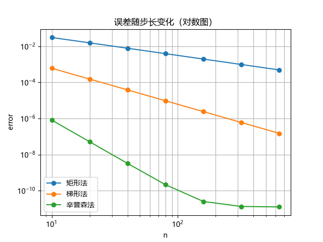

# 三种数值积分方法对比

## 1. 问题

计算 ∫₀¹ e^(−x²) dx。

没有初等原函数，参考值：0.7468241328

## 2. 三种方法

- 矩形法：矩形
- 梯形法：梯形
- 辛普森法：抛物线

## 3. 结果

把误差图放进来：

## 4. 结论

- 精度排序：辛普森法>梯形法>矩形法
- 实测收敛阶：矩形法 ≈ 1，梯形法 ≈ 2，辛普森法 ≈ 4
- 浮点精度极限：1e−11
- 一句话总结：三种方法的性价比差距巨大：达到同样精度，辛普森法所需的计算量比矩形法少数个数量级。