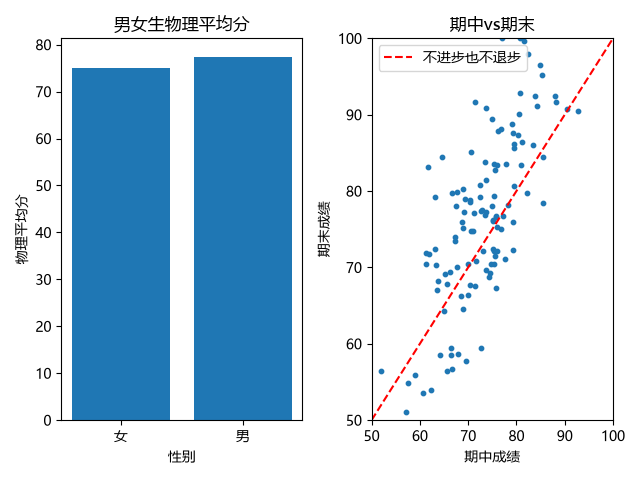

# 学生成绩数据分析报告

## 1. 数据是什么
随即生成的数据,120个学生,学号,班级,物理,数学,性别,期中,期末,作业

## 2. 数据质量检查
（5个物理成绩确实 + 去掉 + 不影响后续计算）

## 3. 三个发现
### 发现一：
数据有缺失，占 4.2%
### 发现二：
平均进步 +2.28 分，但个体差异极大
### 发现三：
性别差异是随机波动，不是真实差异

## 4. 图

## 5. 一句话总结
能够用代码进行一些表格数据的统计计算